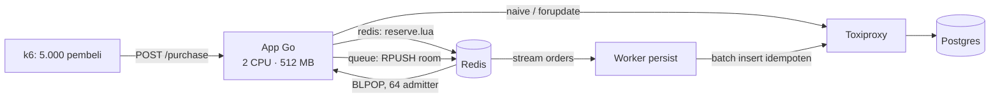

# War Tiket

Pernah ikut war tiket konser? Jam 10 pas, ribuan orang mencet "Beli" barengan, padahal kursinya cuma beberapa ratus. Dari sisi pembeli rasanya deg-degan. Dari sisi backend, ini salah satu skenario yang paling gampang bikin sistem salah hitung.

Project ini aku bikin untuk menjawab pertanyaan sederhana: gimana caranya stok tiket tetap benar waktu diserbu, dan berapa harga yang harus dibayar untuk tiap caranya?

Hasilnya bisa di-replay di **[kocwng.github.io/war-ticket](https://kocwng.github.io/war-ticket/)**.

Aku mencoba empat pendekatan, dari yang paling polos sampai yang biasa dipakai di sistem besar:

1. **naive**. Baca stok, kalau masih ada, kurangi. Dua query terpisah tanpa lock. Versi ini sering lolos code review karena sekilas kelihatan benar.
2. **forupdate**. Sama, tapi baris stok di-lock dengan `SELECT … FOR UPDATE` selama transaction.
3. **redis**. Stok dipindah ke Redis dan di-decrement lewat Lua script yang atomic. Tiket di-persist ke Postgres secara async oleh worker.
4. **queue**. Pembeli masuk waiting room dulu, lalu diproses secara FIFO lewat request path Redis tadi.

## Hasilnya

Tiap strategi aku serbu dengan 5.000 pembeli (1.000 virtual user k6) untuk stok 500. App-nya dibatasi 2 CPU dan 512 MB dan jalan di MacBook M2. Setiap strategi dijalankan lima kali secara interleaved, dan angka di bawah adalah mediannya. Angka di dalam kurung adalah range min–max dari lima run itu.

| Strategi | Tiket terbit | Oversold | Consistent | p50 | p99 |
|---|---:|---:|:---:|---:|---:|
| `naive` | 1.000 | **500** | 0 dari 5 | 75 ms (72–94) | 368 ms (321–484) |
| `forupdate` | 500 | 0 | 5 dari 5 | 207 ms (194–212) | 426 ms (400–953) |
| `redis` | 500 | 0 | 5 dari 5 | 37 ms (27–38) | 87 ms (50–203) |
| `queue` | 500 | 0 | 5 dari 5 | 33 ms (6–36) | 95 ms (71–259) |

Latency `queue` di atas cuma waktu request purchase. Kalau dihitung sampai statusnya final, pembeli yang sempat masuk queue menunggu sekitar 277 ms (p99).

Versi naive menjual 1.000 tiket untuk stok 500, dan itu terjadi di kelima run. Penyebabnya klasik. Seribu request pertama sama-sama membaca "stok masih ada" sebelum satu pun `UPDATE` selesai. Waktu aku tulis test-nya dengan 400 goroutine dan stok 50, hasilnya malah lebih parah, 400 tiket terbit.

`FOR UPDATE` memang membereskan masalah itu, tapi semua request jadi menunggu lock di satu baris yang sama. Median latency-nya 207 ms, sekitar lima kali lebih lambat dari versi Redis.

Versi Redis jauh lebih cepat karena database tidak lagi ada di request path. Stok di-decrement in-memory, tiketnya ditulis ke stream, lalu worker yang persist ke Postgres. Setelah run selesai, stok di Redis dan di Postgres tetap sama dan persist lag-nya nol.

Waiting room hasilnya mirip Redis, karena concurrency ke stok dibatasi 64 worker. Begitu stok habis, request baru langsung dibalas 409 sold out tanpa masuk queue.

### Kalau database melambat

Bagian ini yang paling menarik buatku. Aku ulangi benchmark yang sama, tapi latency setiap query ke Postgres ditambah 40 ms (±10 ms) lewat Toxiproxy. Kondisi seperti ini wajar terjadi di production, misalnya waktu database sedang sibuk atau ada network issue.

| Strategi | Tiket terbit | Oversold | Error 504 | p50 | p99 |
|---|---:|---:|---:|---:|---:|
| `naive` | 0 | 0 | 5.000 | 2 dtk | 2,1 dtk |
| `forupdate` | 1 (0–4) | 0 | 4.999 | 2 dtk | 2,2 dtk |
| `redis` | 500 | 0 | 0 | 36 ms | 110 ms |
| `queue` | 500 | 0 | 0 | 43 ms | 172 ms |

Dua strategi yang bergantung ke database langsung lumpuh. Hampir semua pembeli dapat 504 setelah menunggu 2 detik, dan tiketnya praktis tidak terjual sama sekali, padahal stok masih 500.

Awalnya aku kira ada yang salah dengan benchmark-nya, karena satu request yang aku kirim manual tetap berhasil dalam sekitar 180 ms. Ternyata masalahnya di connection pool. Seribu request rebutan 20 koneksi database. Versi naive butuh empat query per request, dan setiap query harus acquire koneksi lagi dari pool. Akibatnya tidak ada satu pun request yang sempat menyelesaikan keempat query-nya dalam 2 detik. Database sebenarnya terus bekerja, tapi semua hasil kerjanya terbuang untuk request yang ujungnya timeout.

Untuk memastikan, aku jalankan versi naive lagi dengan database yang sama lambatnya, hanya concurrency-nya yang dikurangi.

| Concurrency | Tiket terbit | Oversold | p50 |
|---|---:|---:|---:|
| 50 VU | 500 | 0 | 298 ms |
| 200 VU | 600 | 100 | 1,5 dtk |
| 1.000 VU | 0 | 0 | 2 dtk |

Kodenya sama persis. Di concurrency rendah semuanya terlihat benar, di concurrency menengah race condition-nya muncul, dan di concurrency penuh sistemnya collapse dan tidak bisa menjual apa-apa. Ini alasan kenapa test fungsional saja tidak cukup untuk sistem seperti ini.

Redis dan waiting room hampir tidak terpengaruh karena database tidak ada di request path. Yang melambat cuma worker yang persist ke Postgres, dan itu terjadi di background tanpa dirasakan pembeli.

Raw data semua run ada di [`results-published/`](results-published/), termasuk `summary.md` di setiap folder series. Kodenya dari commit `4fdb181`. Run ini tercatat sebagai `4fdb181-dirty` karena skrip benchmark dan Makefile sedang diubah waktu itu. Kode app-nya sendiri tidak berubah.

## Cara kerjanya



Semua implementasi berpegang pada satu API contract, [`api/openapi.yaml`](api/openapi.yaml). Contract itu diuji dari luar oleh [`bench/k6/smoke.js`](bench/k6/smoke.js), jadi nanti versi Python dan Rust harus lulus test yang sama sebelum boleh ikut dibandingkan. Dengan begitu yang dibandingkan benar-benar apel dengan apel.

Satu user cuma boleh punya satu tiket per event. Aturan ini sekaligus bikin endpoint purchase jadi idempotent. Kalau ada yang mencet Beli dua kali karena sinyalnya putus-putus, dia dapat tiket yang sama, bukan dua tiket. Di Postgres aturannya dijaga oleh `UNIQUE (event_id, user_id)`, di Redis oleh hash `buyers`.

Strategi Redis menulis ke Postgres secara async, jadi aku perlu memastikan tidak ada tiket yang hilang di tengah jalan. Worker baru ACK message setelah datanya benar-benar tersimpan, dan insert-nya pakai `ON CONFLICT DO NOTHING`. Kalau worker crash di tengah proses, pending message dibaca ulang waktu dia restart, dan tiketnya tidak akan dobel. Jaminannya at-least-once delivery.

State waiting room juga disimpan di Redis, bukan in-memory di app. Jadi kalau app dijalankan lebih dari satu instance, semuanya tetap berbagi queue yang sama.

Kalau in-flight request sudah melewati `MAX_INFLIGHT`, request berikutnya langsung ditolak dengan 503 (load shedding). Menurutku lebih baik fail fast untuk sebagian pembeli daripada bikin semuanya menunggu lama lalu timeout bareng.

Koneksi ke Postgres sengaja lewat Toxiproxy. Dengan itu aku bisa inject latency ke database di tengah run (`make chaos-on`) dan melihat strategi mana yang paling kena dampaknya.

Satu lagi, kolom `stock` sengaja tidak diberi `CHECK (stock >= 0)` supaya kebocoran di versi naive kelihatan. Di production, constraint itu wajib ada.

## Mencoba sendiri

Yang perlu terpasang cuma Docker, `curl`, dan `jq`. k6 jalan di dalam container. Go 1.25+ hanya dibutuhkan kalau mau menjalankan test di luar container.

```bash
make up                 # Postgres, Redis, Toxiproxy, dan app Go di :8088
make test-integration   # test race condition
make smoke              # contract test untuk keempat strategi
make compare            # satu run keempat strategi, 5.000 pembeli, stok 500
make series             # lima run per strategi, lalu tabel median
```

Kalau mau coba dengan angka lain:

```bash
make bench STRATEGY=queue BUYERS=10000 STOCK=1000
```

Kalau mau lihat apa yang terjadi saat database melambat:

```bash
make chaos-on && make series LABEL=db-lambat; make chaos-off
```

Setiap run menyimpan tiga file (`meta.json`, `report.json`, dan `k6-summary.json`) di `results/<waktu>-go-<strategi>/`. Penjelasan lengkapnya ada di [`bench/README.md`](bench/README.md).

## Halaman replay

Folder [`docs/`](docs/) berisi halaman yang me-replay hasil benchmark di atas, dan versi online-nya ada di [kocwng.github.io/war-ticket](https://kocwng.github.io/war-ticket/). Di sana kelihatan garis stok menembus nol di versi naive, atau seribu request yang tertahan sampai timeout waktu database lambat. Datanya diambil dari `results-published/` lewat `./bench/export-replay.sh`, jadi kalau ada hasil benchmark baru, jalankan skrip itu lagi.

Untuk membukanya di laptop:

```bash
python3 -m http.server 3370 --directory docs
```

Lalu buka http://localhost:3370.

## Isi repo

```
api/openapi.yaml          API contract bersama
migrations/               schema Postgres bersama
impl/go/                  implementasi Go
  cmd/server/             main, wiring, graceful shutdown
  internal/store/         strategi naive & forupdate, batch persist
  internal/redisstock/    reserve.lua, stok Redis, persist lag
  internal/queue/         waiting room + admitter
  internal/persist/       worker stream → Postgres
  internal/stats/         counter + timeline 10 ms untuk replay
  internal/httpapi/       handler, load shedding, metrics Prometheus
  internal/integration_test/  test race condition
bench/                    k6 spike & smoke, run/compare/chaos
deploy/                   config Toxiproxy & Prometheus
```

## Yang belum sempurna

Counter dan timeline di `/admin/report` disimpan in-memory per process, jadi angkanya cuma akurat kalau app jalan satu instance (dan memang begitu di benchmark ini). Kalau nanti di-scale, metriknya sebaiknya diambil dari Prometheus lewat `/metrics`.

`reserve.lua` mengakses key lintas slot karena stream `orders` dipakai bersama untuk semua event. Di Redis single node ini aman, tapi kalau pindah ke Redis Cluster, stream-nya harus dipecah per event.

k6, app, dan database jalan di laptop yang sama, jadi angka absolutnya ikut dipengaruhi load generator. Yang lebih bisa dipegang adalah perbandingan antarstrategi.

`MAX_INFLIGHT` sekarang angka tetap (1.000), jauh di atas kapasitas database saat sedang lambat. Itu sebabnya strategi berbasis DB collapse di skenario slow DB, bukannya load shedding. Adaptive concurrency limit yang mengikuti latency database seharusnya bisa mencegah itu.

## Selanjutnya

- [ ] Adaptive concurrency limit, lalu ulangi skenario slow DB
- [ ] Versi Python (FastAPI) dan Rust (axum) dengan API contract yang sama
- [ ] Endpoint CPU-bound, misalnya signing e-ticket, supaya perbedaan antarbahasa lebih kelihatan
- [x] Halaman replay untuk hasil di `results-published/`
