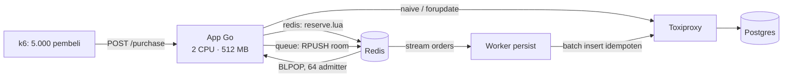

# War Tiket

Pernah ikut war tiket konser? Jam 10 pas, ribuan orang mencet "Beli" barengan, padahal kursinya cuma beberapa ratus. Dari sisi pembeli rasanya deg-degan. Dari sisi backend, ini salah satu skenario yang paling gampang bikin sistem salah hitung.

Project ini aku bikin untuk menjawab pertanyaan sederhana: gimana caranya stok tiket tetap benar waktu diserbu, dan berapa harga yang harus dibayar untuk tiap caranya?

Aku mencoba empat pendekatan, dari yang paling polos sampai yang biasa dipakai di sistem besar:

1. **naive**. Baca stok, kalau masih ada, kurangi. Dua query terpisah tanpa lock. Versi ini sering lolos code review karena sekilas kelihatan benar.
2. **forupdate**. Sama, tapi baris stok dikunci dengan `SELECT … FOR UPDATE` selama transaksi.
3. **redis**. Stok dipindah ke Redis dan dikurangi lewat skrip Lua yang atomik. Postgres diisi belakangan oleh worker.
4. **queue**. Pembeli masuk ruang tunggu dulu, lalu diproses bergiliran lewat jalur Redis tadi.

## Hasilnya

Tiap strategi aku serbu dengan 5.000 pembeli (1.000 virtual user k6) untuk stok 500. App-nya dibatasi 2 CPU dan 512 MB dan jalan di MacBook M2. Setiap strategi dijalankan lima kali secara selang-seling, dan angka di bawah adalah mediannya. Angka di dalam kurung adalah rentang dari lima run itu.

| Strategi | Tiket terbit | Oversold | Data konsisten | p50 | p99 |
|---|---:|---:|:---:|---:|---:|
| `naive` | 1.000 | **500** | 0 dari 5 | 75 ms (72–94) | 368 ms (321–484) |
| `forupdate` | 500 | 0 | 5 dari 5 | 207 ms (194–212) | 426 ms (400–953) |
| `redis` | 500 | 0 | 5 dari 5 | 37 ms (27–38) | 87 ms (50–203) |
| `queue` | 500 | 0 | 5 dari 5 | 33 ms (6–36) | 95 ms (71–259) |

Angka latency `queue` di atas cuma waktu request beli. Kalau dihitung sampai statusnya final, pembeli yang sempat antre menunggu sekitar 277 ms (p99).

Versi naive menjual 1.000 tiket untuk stok 500, dan itu terjadi di kelima run. Penyebabnya klasik. Seribu request pertama sama-sama membaca "stok masih ada" sebelum satu pun `UPDATE` selesai. Waktu aku tulis test-nya dengan 400 goroutine dan stok 50, hasilnya malah lebih parah, 400 tiket terbit.

`FOR UPDATE` memang membereskan masalah itu, tapi semua pembeli jadi antre di satu baris yang sama. Median latency-nya 207 ms, sekitar lima kali lebih lambat dari versi Redis.

Versi Redis jauh lebih cepat karena database tidak lagi ada di jalur utama. Stok dikurangi di memori, tiketnya dicatat ke stream, lalu worker yang memasukkannya ke Postgres. Setelah run selesai, stok di Redis dan di Postgres tetap cocok dan tidak ada pesanan yang tertinggal.

Waiting room hasilnya mirip Redis, karena yang boleh menyentuh stok cuma 64 worker. Begitu stok habis, pembeli yang baru datang langsung dapat jawaban "habis" tanpa perlu antre dulu.

### Kalau database melambat

Bagian ini yang paling menarik buatku. Aku ulangi benchmark yang sama, tapi setiap query ke Postgres sengaja diperlambat 40 ms (±10 ms) lewat Toxiproxy. Kondisi seperti ini wajar terjadi di production, misalnya waktu database sedang sibuk atau ada gangguan jaringan.

| Strategi | Tiket terbit | Oversold | Error 504 | p50 | p99 |
|---|---:|---:|---:|---:|---:|
| `naive` | 0 | 0 | 5.000 | 2 dtk | 2,1 dtk |
| `forupdate` | 1 (0–4) | 0 | 4.999 | 2 dtk | 2,2 dtk |
| `redis` | 500 | 0 | 0 | 36 ms | 110 ms |
| `queue` | 500 | 0 | 0 | 43 ms | 172 ms |

Dua strategi yang bergantung ke database langsung lumpuh. Hampir semua pembeli dapat 504 setelah menunggu 2 detik, dan tiketnya praktis tidak terjual sama sekali, padahal stok masih 500.

Awalnya aku kira ada yang salah dengan benchmark-nya, karena satu request yang aku kirim manual tetap berhasil dalam sekitar 180 ms. Ternyata masalahnya di antrean. Seribu request rebutan 20 koneksi database. Versi naive butuh empat query per request, dan setiap query harus antre koneksi lagi dari awal. Akibatnya tidak ada satu pun request yang sempat menyelesaikan keempat query-nya dalam 2 detik. Database sebenarnya terus bekerja, tapi semua hasil kerjanya terbuang untuk request yang ujungnya timeout.

Untuk memastikan, aku jalankan versi naive lagi dengan database yang sama lambatnya, hanya bebannya yang dikurangi.

| Beban | Tiket terbit | Oversold | p50 |
|---|---:|---:|---:|
| 50 VU | 500 | 0 | 298 ms |
| 200 VU | 600 | 100 | 1,5 dtk |
| 1.000 VU | 0 | 0 | 2 dtk |

Kodenya sama persis. Di beban kecil semuanya terlihat benar, di beban menengah bug race condition-nya muncul, dan di beban penuh sistemnya malah tidak bisa menjual apa-apa. Ini alasan kenapa test fungsional saja tidak cukup untuk sistem seperti ini.

Redis dan waiting room hampir tidak terpengaruh karena database tidak ada di jalur beli. Yang melambat cuma worker yang menulis ke Postgres, dan itu terjadi di belakang tanpa dirasakan pembeli.

Data mentah semua run ada di [`results-published/`](results-published/), termasuk `summary.md` di setiap folder seri. Kodenya dari commit `4fdb181`. Run ini tercatat sebagai `4fdb181-dirty` karena skrip benchmark dan Makefile sedang diubah waktu itu. Kode app-nya sendiri tidak berubah.

## Cara kerjanya



Semua implementasi berpegang pada satu kontrak, [`api/openapi.yaml`](api/openapi.yaml). Kontrak itu diuji dari luar oleh [`bench/k6/smoke.js`](bench/k6/smoke.js), jadi nanti versi Python dan Rust harus lulus test yang sama sebelum boleh ikut dibandingkan. Dengan begitu yang dibandingkan benar-benar apel dengan apel.

Satu user cuma boleh punya satu tiket per event. Aturan ini sekaligus bikin endpoint beli jadi idempoten. Kalau ada yang mencet Beli dua kali karena sinyalnya putus-putus, dia dapat tiket yang sama, bukan dua tiket. Di Postgres aturannya dijaga oleh `UNIQUE (event_id, user_id)`, di Redis oleh hash `buyers`.

Jalur Redis menulis ke Postgres secara asinkron, jadi aku perlu memastikan tidak ada tiket yang hilang di tengah jalan. Worker baru mengonfirmasi (ACK) pesan setelah datanya benar-benar tersimpan, dan insert-nya pakai `ON CONFLICT DO NOTHING`. Kalau worker mati di tengah proses, pesan yang belum beres dibaca ulang waktu dia hidup lagi, dan tiketnya tidak akan dobel.

Ruang tunggunya juga disimpan di Redis, bukan di memori aplikasi. Jadi kalau app dijalankan lebih dari satu instance, semuanya tetap berbagi antrean yang sama.

Kalau request yang sedang diproses sudah melewati `MAX_INFLIGHT`, request berikutnya langsung ditolak dengan 503. Menurutku lebih baik menolak sebagian pembeli dengan cepat daripada bikin semuanya menunggu lama lalu timeout bareng.

Koneksi ke Postgres sengaja lewat Toxiproxy. Dengan itu aku bisa bikin database melambat di tengah run (`make chaos-on`) dan melihat strategi mana yang paling kena dampaknya.

Satu lagi, kolom `stock` sengaja tidak diberi `CHECK (stock >= 0)` supaya kebocoran di versi naive kelihatan. Di production, constraint itu wajib ada.

## Mencoba sendiri

Yang perlu terpasang cuma Docker, `curl`, dan `jq`. k6 jalan di dalam container. Go 1.25+ hanya dibutuhkan kalau mau menjalankan test di luar container.

```bash
make up                 # Postgres, Redis, Toxiproxy, dan app Go di :8088
make test-integration   # test race condition
make smoke              # uji kontrak untuk keempat strategi
make compare            # satu putaran keempat strategi, 5.000 pembeli, stok 500
make series             # lima putaran, lalu tabel median
```

Kalau mau coba dengan angka lain:

```bash
make bench STRATEGY=queue BUYERS=10000 STOCK=1000
```

Kalau mau lihat apa yang terjadi saat database melambat:

```bash
make chaos-on && make series LABEL=db-lambat; make chaos-off
```

Setiap run menyimpan tiga file (`meta.json`, `report.json`, dan `k6-summary.json`) di `results/<waktu>-go-<strategi>/`. Penjelasan lengkapnya ada di [`bench/README.md`](bench/README.md).

## Isi repo

```
api/openapi.yaml          kontrak HTTP bersama
migrations/               skema Postgres bersama
impl/go/                  implementasi Go
  cmd/server/             main, wiring, graceful shutdown
  internal/store/         strategi naive & forupdate, batch persist
  internal/redisstock/    reserve.lua, stok Redis, persist lag
  internal/queue/         waiting room + admitter
  internal/persist/       worker stream → Postgres
  internal/stats/         penghitung + timeline 10 ms untuk replay
  internal/httpapi/       handler, load shedding, metrik Prometheus
  internal/integration_test/  test race condition
bench/                    k6 spike & smoke, run/compare/chaos
deploy/                   konfigurasi Toxiproxy & Prometheus
```

## Yang belum sempurna

Penghitung dan timeline di `/admin/report` disimpan di memori proses, jadi angkanya cuma akurat kalau app jalan satu instance (dan memang begitu di benchmark ini). Kalau nanti di-scale, metriknya sebaiknya diambil dari Prometheus lewat `/metrics`.

`reserve.lua` mengakses key lintas slot karena stream `orders` dipakai bersama untuk semua event. Di Redis single node ini aman, tapi kalau pindah ke Redis Cluster, stream-nya harus dipecah per event.

k6, app, dan database jalan di laptop yang sama, jadi angka absolutnya ikut dipengaruhi load generator. Yang lebih bisa dipegang adalah perbandingan antarstrategi.

Batas `MAX_INFLIGHT` sekarang angka tetap (1.000), jauh di atas kemampuan database saat sedang lambat. Itu sebabnya strategi berbasis DB lumpuh di skenario DB lambat, bukannya menolak sebagian pembeli dengan cepat. Batas yang menyesuaikan diri dengan latency database seharusnya bisa mencegah itu.

## Selanjutnya

- [ ] Batas request yang menyesuaikan latency (adaptive concurrency limit), lalu ulangi skenario DB lambat
- [ ] Versi Python (FastAPI) dan Rust (axum) dengan kontrak yang sama
- [ ] Endpoint yang berat di CPU, misalnya tanda tangan e-ticket, supaya perbedaan antarbahasa lebih kelihatan
- [ ] Halaman demo yang memutar ulang hasil di `results-published/`
